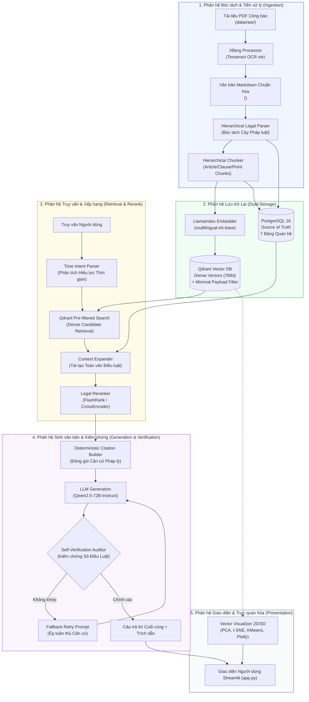
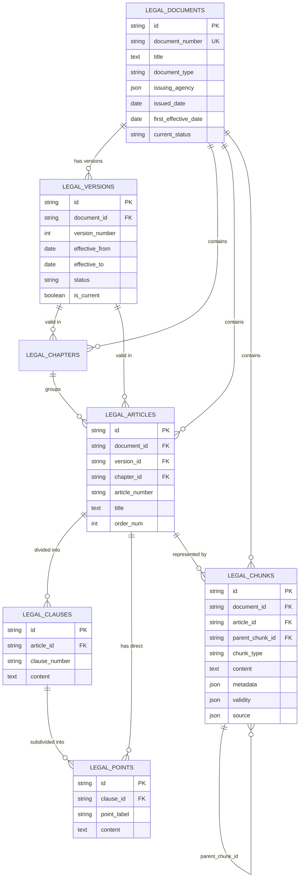
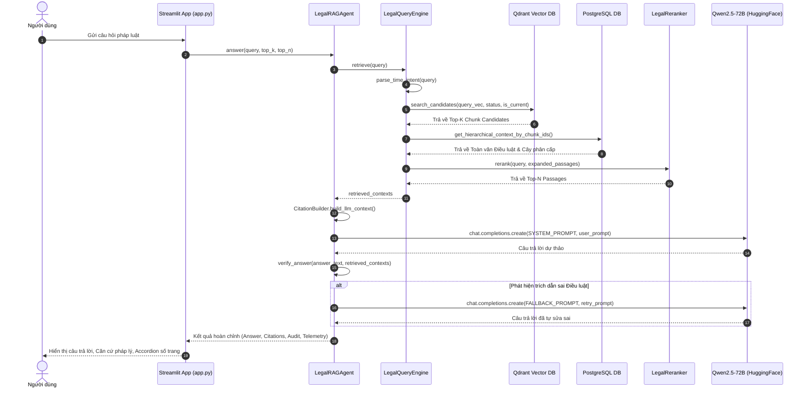
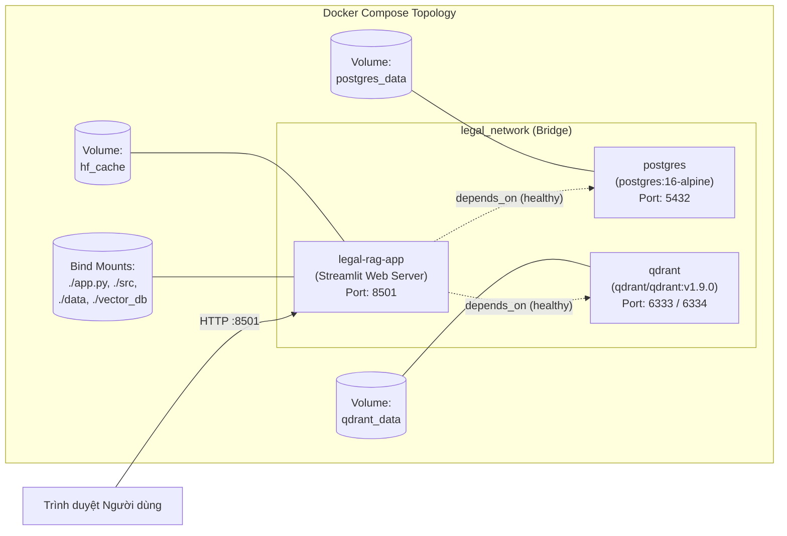

# Kiến trúc Hệ thống Tra cứu Luật Giao thông Đường bộ Việt Nam (LegalGPT)

Tài liệu này mô tả chi tiết kiến trúc tổng thể, các nguyên lý thiết kế, cấu trúc dữ liệu, luồng xử lý và mô hình triển khai của **Hệ thống Tra cứu Luật Giao thông Đường bộ Việt Nam**.

---

## 1. Giới thiệu và Mục tiêu Thiết kế

### 1.1. Bối cảnh bài toán
Pháp luật giao thông đường bộ Việt Nam là một hệ thống văn bản quy phạm phức tạp với tính phân tầng cao (Luật $\rightarrow$ Nghị định $\rightarrow$ Thông tư) và luôn cập nhật theo thời gian (ví dụ: Luật Trật tự, an toàn giao thông đường bộ 2024 số **36/2024/QH15**, Luật Đường bộ 2024 số **35/2024/QH15**, Nghị định xử phạt vi phạm hành chính số **168/2024/NĐ-CP**).

Các hệ thống RAG (Retrieval-Augmented Generation) truyền thống áp dụng kỹ thuật chia đoạn văn bản theo độ dài cố định (Naive Chunking) thường gặp phải các hạn chế nghiêm trọng trong miền pháp luật:
1. **Phân mảnh ngữ cảnh (Context Fragmentation)**: Một Điều luật bị cắt ngang giữa chừng, làm mất đi điều kiện tiên quyết ở đầu Điều hoặc các trường hợp ngoại lệ ở các Khoản cuối.
2. **Ảo giác số Điều (Citation Hallucination)**: Mô hình LLM tự sinh hoặc nhầm lẫn số Điều, số Nghị định giữa các văn bản cũ và mới.
3. **Mù mờ về hiệu lực thời gian (Temporal Blindness)**: Không phân biệt được quy định đang có hiệu lực hiện hành với quy định đã hết hiệu lực hoặc chưa áp dụng.

### 1.2. Mục tiêu kiến trúc (Architectural Goals)
- **Tính toàn vẹn cấu trúc (Structural Integrity)**: Giữ nguyên cây cấu trúc nguyên bản: **Văn bản $\rightarrow$ Chương $\rightarrow$ Điều $\rightarrow$ Khoản $\rightarrow$ Điểm**.
- **Độ chính xác xác thực 100% (Zero Hallucination with Verification)**: Tự động đối soát mọi số Điều luật xuất hiện trong câu trả lời với cơ sở dữ liệu quan hệ; tự động kích hoạt vòng lặp tự sửa sai nếu phát hiện trích dẫn sai lệch.
- **Lưu trữ lai hai lớp (Dual-Storage Architecture)**: Tách bạch rõ rệt giữa **Source of Truth** (PostgreSQL lưu cây cấu trúc quan hệ toàn văn) và **Vector Index** (Qdrant lưu vector đặc trưng cùng payload lọc trước tối giản).
- **Nhận thức ý định thời gian (Time-Intent Awareness)**: Tự động phân tích câu hỏi người dùng để lọc văn bản hiện hành (`active`, `is_current=True`) hoặc truy cứu văn bản lịch sử theo mốc thời gian cụ thể.
- **Khả năng phục hồi và hoạt động độc lập (Graceful Degradation & Fallbacks)**: Tự động chuyển đổi sang SQLite và Qdrant Local/In-memory khi không có máy chủ PostgreSQL/Qdrant độc lập.

---

## 2. Kiến trúc Tổng thể (High-Level Architecture)

Hệ thống được tổ chức thành 6 phân hệ mô-đun kết nối chặt chẽ theo luồng dữ liệu một chiều khép kín:

---

## 3. Chi tiết các Phân hệ Chuyên trách

### 3.1. Phân hệ Bóc tách và Tiền xử lý (Ingestion Subsystem)
Các thành phần chính nằm trong thư mục [`src/ingestion/`](file:///E:/Python/He-thong-tra-cuu-luat-giao-thong-duong-bo-Viet-Nam/src/ingestion):

- **[`xberg_processor.py`](file:///E:/Python/He-thong-tra-cuu-luat-giao-thong-duong-bo-Viet-Nam/src/ingestion/xberg_processor.py)**:
  - Khởi tạo [`XbergProcessor`](file:///E:/Python/He-thong-tra-cuu-luat-giao-thong-duong-bo-Viet-Nam/src/ingestion/xberg_processor.py#L86-L179) tích hợp thư viện `xberg` và động cơ OCR Tesseract (`vie.traineddata`).
  - Hỗ trợ chế độ tự phát hiện trang dạng ảnh/scan hoặc cờ ép buộc OCR (`--force-ocr`).
  - Chèn thẻ đánh dấu trang `<!-- PAGE {page_num} -->` làm cơ sở truy vết số trang vật lý.
  - Hàm [`normalize_xberg_markdown`](file:///E:/Python/He-thong-tra-cuu-luat-giao-thong-duong-bo-Viet-Nam/src/ingestion/xberg_processor.py#L24-L84): Chuẩn hóa Unicode NFC, phân tách Chương và Điều bị gom dính trên một dòng Markdown, loại bỏ định dạng gạch đầu dòng Markdown `- 1\.` $\rightarrow$ `1.`, làm sạch phần đầu trang (Công báo, Quốc hội) mà vẫn giữ nguyên cấu trúc điều khoản.

- **[`data_loader.py`](file:///E:/Python/He-thong-tra-cuu-luat-giao-thong-duong-bo-Viet-Nam/src/ingestion/data_loader.py)**:
  - Quản lý [`IngestionManifest`](file:///E:/Python/He-thong-tra-cuu-luat-giao-thong-duong-bo-Viet-Nam/src/ingestion/data_loader.py#L47-L122): Tính mã băm tệp PDF (SHA-256) và mã băm cấu hình trích xuất (Config Hash bao gồm OCR strategy, language, tessdata).
  - Cho phép phục hồi và bỏ qua các tệp đã xử lý (Resume & Incremental Ingestion), tiết kiệm tài nguyên khi chạy định kỳ.

- **[`legal_parser.py`](file:///E:/Python/He-thong-tra-cuu-luat-giao-thong-duong-bo-Viet-Nam/src/ingestion/legal_parser.py)**:
  - Lớp [`HierarchicalLegalParser`](file:///E:/Python/He-thong-tra-cuu-luat-giao-thong-duong-bo-Viet-Nam/src/ingestion/legal_parser.py#L20-L506) bóc tách văn bản thành cây cấu trúc JSON hoàn chỉnh.
  - Tích hợp các bộ quy tắc từ [`legal_rules.py`](file:///E:/Python/He-thong-tra-cuu-luat-giao-thong-duong-bo-Viet-Nam/src/core/legal_rules.py#L5-L94) để tự động nhận dạng cơ quan ban hành (`QUOC_HOI`, `CHINH_PHU`, `BCA`, `BGTVT`...) và loại văn bản (`luat`, `nghi_dinh`, `thong_tu`).
  - Trích xuất tự động ngày ban hành (`issued_date`) và ngày bắt đầu có hiệu lực (`effective_from`).
  - Gắn thẻ số trang bắt đầu (`page_start`) và kết thúc (`page_end`) cho từng Chương, Điều, Khoản, Điểm dựa trên vị trí ký tự so với các thẻ `<!-- PAGE {n} -->`.

- **[`hierarchical_chunker.py`](file:///E:/Python/He-thong-tra-cuu-luat-giao-thong-duong-bo-Viet-Nam/src/ingestion/hierarchical_chunker.py)**:
  - Lớp [`HierarchicalLegalChunker`](file:///E:/Python/He-thong-tra-cuu-luat-giao-thong-duong-bo-Viet-Nam/src/ingestion/hierarchical_chunker.py#L55-L269) tạo ra 3 cấp độ Chunk:
    1. **Article Root Chunk**: Chứa toàn văn Điều luật, có `parent_chunk_id = None`.
    2. **Clause Chunk**: Tạo khi Khoản không có Điểm con, có `parent_chunk_id` trỏ về Article Root Chunk.
    3. **Point Chunk**: Tạo khi Khoản có các Điểm con, có `parent_chunk_id` trỏ về Article Root Chunk.
  - Bổ sung tiền tố dẫn đường ngữ cảnh (Breadcrumb): `[{doc_title}] [Điều {art_num}: {art_title}] [Khoản {cl_num}] [Điểm {pt_label}]`.
  - Tự động gắn thẻ phân loại chủ đề (`topics`) và hành vi vi phạm (`violation_types`) thông qua khớp từ khóa pháp lý tiếng Việt.

---

### 3.2. Phân hệ Lưu trữ Lai (Dual-Storage Layer)
Hệ thống áp dụng mô hình lưu trữ tách biệt để đảm bảo hiệu năng và tính toàn vẹn dữ liệu:

#### A. PostgreSQL 16 (Relational Source of Truth)
- Quản trị bởi [`PostgresManager`](file:///E:/Python/He-thong-tra-cuu-luat-giao-thong-duong-bo-Viet-Nam/src/storage/postgres_manager.py#L32-L100).
- Lưu trữ 7 bảng quan hệ định nghĩa trong [`models.py`](file:///E:/Python/He-thong-tra-cuu-luat-giao-thong-duong-bo-Viet-Nam/src/core/models.py#L30-L195):
  1. `legal_documents`: Văn bản gốc (Luật, Nghị định, Thông tư), cơ quan ban hành, ngày ban hành.
  2. `legal_versions`: Phiên bản hiệu lực theo thời gian (`effective_from`, `effective_to`, `status`, `is_current`).
  3. `legal_chapters`: Các chương trong văn bản luật.
  4. `legal_articles`: Các Điều trong văn bản, tiêu đề Điều.
  5. `legal_clauses`: Các Khoản được đánh số (1, 2, 3...).
  6. `legal_points`: Các Điểm được đánh chữ cái (a, b, c, đ...).
  7. `legal_chunks`: Các chunk pháp lý phân cấp hoàn chỉnh phục vụ tái tạo ngữ cảnh.
- **Tính toàn vẹn**: Ràng buộc khóa ngoại `ON DELETE CASCADE`, chỉ mục phức hợp tăng tốc truy vấn (`idx_articles_doc_ver`, `idx_clauses_art`, `idx_points_clause`, `idx_chunks_doc_art`, `idx_chunks_parent`).
- **Dự phòng (Fallback)**: Nếu kết nối PostgreSQL gặp sự cố, tự động kích hoạt SQLite Fallback tại `vector_db/legal_relational_fallback.db` mà không làm gián đoạn ứng dụng.

#### B. Qdrant Vector Database
- Quản trị bởi [`QdrantManager`](file:///E:/Python/He-thong-tra-cuu-luat-giao-thong-duong-bo-Viet-Nam/src/storage/qdrant_manager.py#L30-L100).
- Collection: `legal_chunks` (Vector kích thước 768 chiều, khoảng cách Cosine).
- **Chiến lược Payload tối giản (Minimal Payload Pattern)**:
  - Tuyệt đối không lưu toàn văn text dài vào Qdrant để tối ưu bộ nhớ RAM và IOPS.
  - Chỉ lưu các trường lọc quan trọng (`status`, `is_current`, `document_id`, `article_id`, `clause_number`, `point_label`, `topics`, `violation_types`, `page_start`, `page_end`).
  - Thiết lập Payload Indexes cho các trường tìm kiếm thường xuyên (`status`, `is_current`, `topics`, `violation_types`).

---

### 3.3. Phân hệ Truy vấn và Mở rộng Ngữ cảnh (Retrieval & Reranking)
Các thành phần chính nằm trong thư mục [`src/retrieval/`](file:///E:/Python/He-thong-tra-cuu-luat-giao-thong-duong-bo-Viet-Nam/src/retrieval):

1. **Phân tích Ý định Thời gian ([`parse_time_intent`](file:///E:/Python/He-thong-tra-cuu-luat-giao-thong-duong-bo-Viet-Nam/src/retrieval/query_engine.py#L29-L65))**:
   - Trích xuất các biểu thức thời gian trong câu hỏi (ví dụ: *"theo quy định năm 2023"*, *"từ ngày 01/01/2025"*).
   - Tự động quyết định cờ lọc `is_current_only = True` (mặc định) hay mở rộng sang các văn bản cũ theo mốc thời gian cụ thể.
2. **Tìm kiếm Vector có điều kiện (Pre-filtered Dense Retrieval)**:
   - Câu hỏi được sinh vector embedding qua [`LlamaIndexEmbedder`](file:///E:/Python/He-thong-tra-cuu-luat-giao-thong-duong-bo-Viet-Nam/src/storage/indexer.py#L28-L87) với tiền tố `query: ` và chuẩn hóa L2 norm.
   - Tìm kiếm Top-$K$ ứng viên trong Qdrant kết hợp bộ lọc Payload (`status = 'active'`, `is_current = True`).
3. **Mở rộng Ngữ cảnh Phân cấp ([`HierarchicalContextExpander`](file:///E:/Python/He-thong-tra-cuu-luat-giao-thong-duong-bo-Viet-Nam/src/retrieval/context_expander.py#L5-L80))**:
   - Từ các chunk con (Điểm, Khoản) tìm thấy, truy xuất sang PostgreSQL theo `chunk_id`.
   - Tìm kiếm Điều luật cha (`article_id`), truy vấn toàn bộ các Khoản và Điểm thuộc Điều luật đó từ PostgreSQL.
   - Tái tạo lại cấu trúc Điều luật hoàn chỉnh, bảo đảm mô hình ngôn ngữ nhìn thấy toàn diện bối cảnh pháp lý mà không bị đứt đoạn.
4. **Xếp hạng lại Hai tầng ([`LegalReranker`](file:///E:/Python/He-thong-tra-cuu-luat-giao-thong-duong-bo-Viet-Nam/src/retrieval/reranker.py#L7-L79))**:
   - Sử dụng FlashRank (`ms-marco-TinyBERT-L-2-v2`) siêu nhẹ, tối ưu hóa thực thi trên CPU với độ trễ thấp (< 50ms).
   - Cơ chế fallback linh hoạt sang SentenceTransformer Cross-Encoder (`BAAI/bge-reranker-base`) hoặc sắp xếp theo điểm số cosine ban đầu.
   - Trả về Top-$N$ (mặc định 4) đoạn căn cứ chính xác nhất.

---

### 3.4. Phân hệ Sinh câu trả lời và Tự kiểm chứng (Generation & Self-Verification)
Các thành phần chính nằm trong thư mục [`src/generation/`](file:///E:/Python/He-thong-tra-cuu-luat-giao-thong-duong-bo-Viet-Nam/src/generation):

- **Trích dẫn Tất định ([`CitationBuilder`](file:///E:/Python/He-thong-tra-cuu-luat-giao-thong-duong-bo-Viet-Nam/src/generation/citation_builder.py#L4-L68))**:
  - Đóng gói ngữ cảnh gửi cho LLM với định dạng tường minh `--- [CĂN CỨ PHÁP LÝ #{i}] ---`, chỉ rõ Mã nguồn, Tên văn bản, Số hiệu, Chương, Điều, Hiệu lực áp dụng.
  - Tạo danh sách trích dẫn chuẩn hóa hiển thị trên giao diện (gồm chỉ số, tên luật, điều khoản, hiệu lực, độ tin cậy và tệp nguồn).
- **Mô hình Ngôn ngữ Lớn**:
  - `Qwen/Qwen2.5-72B-Instruct` qua HuggingFace Inference API với cấu hình `temperature=0.15` để duy trì tính nhất quán và nghiêm cẩn pháp lý.
- **Vòng lặp Tự Kiểm chứng (Self-Verification Loop)**:
  - Hàm [`verify_answer`](file:///E:/Python/He-thong-tra-cuu-luat-giao-thong-duong-bo-Viet-Nam/src/generation/agent.py#L95-L125) quét toàn bộ các cụm `Điều \d+` trong câu trả lời của LLM bằng Regex.
  - So sánh tập hợp số Điều được trích dẫn với tập hợp số Điều thực sự có trong các căn cứ pháp lý được cung cấp từ PostgreSQL.
  - Nếu phát hiện số Điều lạ (ảo giác), hệ thống tự động kích hoạt lời nhắc phụ (`FALLBACK_SYSTEM_PROMPT`) để ép mô hình trả lời lại, chỉ được phép sử dụng các số Điều có trong dữ liệu nạp.

---

## 4. Mô hình Triển khai và Cơ sở Hạ tầng (DevOps & Infrastructure)

Hệ thống được đóng gói thông qua Docker Compose ([`docker-compose.yml`](file:///E:/Python/He-thong-tra-cuu-luat-giao-thong-duong-bo-Viet-Nam/docker-compose.yml)):

### 4.1. Dịch vụ và Phân vùng
1. **`postgres` (`postgres:16-alpine`)**:
   - Lưu trữ toàn bộ dữ liệu quan hệ, phiên bản và cây điều khoản.
   - Kiểm tra sức khỏe container bằng lệnh `pg_isready`.
   - Phân vùng bền vững: `postgres_data`.
2. **`qdrant` (`qdrant/qdrant:v1.9.0`)**:
   - Lưu trữ không gian vector và thực thi tìm kiếm tương đồng ngữ nghĩa.
   - Kiểm tra sức khỏe cổng socket 6333.
   - Phân vùng bền vững: `qdrant_data`.
3. **`legal-rag-app`**:
   - Môi trường chạy ứng dụng Python 3.13 và giao diện Streamlit.
   - Khởi động sau khi PostgreSQL và Qdrant đã ở trạng thái `service_healthy`.
   - Phân vùng lưu bộ nhớ đệm mô hình Hugging Face: `hf_cache`.

---

## 5. Bảng Đối Chiếu Thành Phần và Tệp Nguồn (Module Mapping)

| Phân hệ / Trách nhiệm | Tệp Nguồn / Thư mục | Các Lớp & Hàm Trọng tâm |
| :--- | :--- | :--- |
| **Cấu hình & Biến môi trường** | [`src/core/config.py`](file:///E:/Python/He-thong-tra-cuu-luat-giao-thong-duong-bo-Viet-Nam/src/core/config.py) | `resolve_tessdata_dir`, `get_llama_cloud_api_keys`, các biến kết nối DB |
| **Quy tắc Pháp lý** | [`src/core/legal_rules.py`](file:///E:/Python/He-thong-tra-cuu-luat-giao-thong-duong-bo-Viet-Nam/src/core/legal_rules.py) | `LEGAL_AGENCIES_CONFIG`, `DEFAULT_AGENCY` |
| **Lược đồ Dữ liệu (ORM & Schemas)** | [`src/core/models.py`](file:///E:/Python/He-thong-tra-cuu-luat-giao-thong-duong-bo-Viet-Nam/src/core/models.py) | `LegalDocumentORM`, `LegalArticleORM`, `LegalChunkORM`, `QdrantChunkPayload` |
| **Bóc tách PDF qua XBerg** | [`src/ingestion/xberg_processor.py`](file:///E:/Python/He-thong-tra-cuu-luat-giao-thong-duong-bo-Viet-Nam/src/ingestion/xberg_processor.py) | [`XbergProcessor`](file:///E:/Python/He-thong-tra-cuu-luat-giao-thong-duong-bo-Viet-Nam/src/ingestion/xberg_processor.py#L86-L179), [`normalize_xberg_markdown`](file:///E:/Python/He-thong-tra-cuu-luat-giao-thong-duong-bo-Viet-Nam/src/ingestion/xberg_processor.py#L24-L84) |
| **Nạp dữ liệu & Bộ nhớ đệm Manifest** | [`src/ingestion/data_loader.py`](file:///E:/Python/He-thong-tra-cuu-luat-giao-thong-duong-bo-Viet-Nam/src/ingestion/data_loader.py) | [`IngestionManifest`](file:///E:/Python/He-thong-tra-cuu-luat-giao-thong-duong-bo-Viet-Nam/src/ingestion/data_loader.py#L47-L122), `process_all_pdfs`, `clean_legal_markdown` |
| **Bóc tách Cây Phân cấp Pháp luật** | [`src/ingestion/legal_parser.py`](file:///E:/Python/He-thong-tra-cuu-luat-giao-thong-duong-bo-Viet-Nam/src/ingestion/legal_parser.py) | [`HierarchicalLegalParser`](file:///E:/Python/He-thong-tra-cuu-luat-giao-thong-duong-bo-Viet-Nam/src/ingestion/legal_parser.py#L20-L506), `extract_document_info`, `parse_markdown` |
| **Tạo Chunks Ngữ nghĩa Phân cấp** | [`src/ingestion/hierarchical_chunker.py`](file:///E:/Python/He-thong-tra-cuu-luat-giao-thong-duong-bo-Viet-Nam/src/ingestion/hierarchical_chunker.py) | [`HierarchicalLegalChunker`](file:///E:/Python/He-thong-tra-cuu-luat-giao-thong-duong-bo-Viet-Nam/src/ingestion/hierarchical_chunker.py#L55-L269), `extract_legal_topics_and_violations` |
| **Pipeline Nạp Dữ liệu Hoàn chỉnh** | [`src/ingestion/ingest_pipeline.py`](file:///E:/Python/He-thong-tra-cuu-luat-giao-thong-duong-bo-Viet-Nam/src/ingestion/ingest_pipeline.py) | `run_ingestion` |
| **Bộ tạo Vector Embeddings** | [`src/storage/indexer.py`](file:///E:/Python/He-thong-tra-cuu-luat-giao-thong-duong-bo-Viet-Nam/src/storage/indexer.py) | [`LlamaIndexEmbedder`](file:///E:/Python/He-thong-tra-cuu-luat-giao-thong-duong-bo-Viet-Nam/src/storage/indexer.py#L28-L87) |
| **Quản trị PostgreSQL (Source of Truth)** | [`src/storage/postgres_manager.py`](file:///E:/Python/He-thong-tra-cuu-luat-giao-thong-duong-bo-Viet-Nam/src/storage/postgres_manager.py) | [`PostgresManager`](file:///E:/Python/He-thong-tra-cuu-luat-giao-thong-duong-bo-Viet-Nam/src/storage/postgres_manager.py#L32-L100), `insert_legal_tree`, `get_hierarchical_context_by_chunk_ids` |
| **Quản trị Qdrant (Vector Index)** | [`src/storage/qdrant_manager.py`](file:///E:/Python/He-thong-tra-cuu-luat-giao-thong-duong-bo-Viet-Nam/src/storage/qdrant_manager.py) | [`QdrantManager`](file:///E:/Python/He-thong-tra-cuu-luat-giao-thong-duong-bo-Viet-Nam/src/storage/qdrant_manager.py#L30-L100), `upsert_chunks`, `search_candidates` |
| **Mở rộng Ngữ cảnh Điều luật** | [`src/retrieval/context_expander.py`](file:///E:/Python/He-thong-tra-cuu-luat-giao-thong-duong-bo-Viet-Nam/src/retrieval/context_expander.py) | [`HierarchicalContextExpander`](file:///E:/Python/He-thong-tra-cuu-luat-giao-thong-duong-bo-Viet-Nam/src/retrieval/context_expander.py#L5-L80), `expand_candidates` |
| **Động cơ Truy vấn & Ý định Thời gian** | [`src/retrieval/query_engine.py`](file:///E:/Python/He-thong-tra-cuu-luat-giao-thong-duong-bo-Viet-Nam/src/retrieval/query_engine.py) | [`LegalQueryEngine`](file:///E:/Python/He-thong-tra-cuu-luat-giao-thong-duong-bo-Viet-Nam/src/retrieval/query_engine.py#L13-L119), `parse_time_intent`, `retrieve` |
| **Mô hình Xếp hạng lại (Reranker)** | [`src/retrieval/reranker.py`](file:///E:/Python/He-thong-tra-cuu-luat-giao-thong-duong-bo-Viet-Nam/src/retrieval/reranker.py) | [`LegalReranker`](file:///E:/Python/He-thong-tra-cuu-luat-giao-thong-duong-bo-Viet-Nam/src/retrieval/reranker.py#L7-L79), `rerank` |
| **Tác tử RAG & Tự kiểm chứng** | [`src/generation/agent.py`](file:///E:/Python/He-thong-tra-cuu-luat-giao-thong-duong-bo-Viet-Nam/src/generation/agent.py) | [`LegalRAGAgent`](file:///E:/Python/He-thong-tra-cuu-luat-giao-thong-duong-bo-Viet-Nam/src/generation/agent.py#L52-L198), `answer`, `verify_answer` |
| **Xây dựng Trích dẫn Tất định** | [`src/generation/citation_builder.py`](file:///E:/Python/He-thong-tra-cuu-luat-giao-thong-duong-bo-Viet-Nam/src/generation/citation_builder.py) | [`CitationBuilder`](file:///E:/Python/He-thong-tra-cuu-luat-giao-thong-duong-bo-Viet-Nam/src/generation/citation_builder.py#L4-L68), `build_llm_context`, `generate_citations` |
| **Chiếu Không gian Vector 2D/3D** | [`src/visualization/vector_visualizer.py`](file:///E:/Python/He-thong-tra-cuu-luat-giao-thong-duong-bo-Viet-Nam/src/visualization/vector_visualizer.py) | [`VectorVisualizer`](file:///E:/Python/He-thong-tra-cuu-luat-giao-thong-duong-bo-Viet-Nam/src/visualization/vector_visualizer.py#L19-L340), `plot_3d_pca`, `plot_2d_tsne` |
| **Giao diện Người dùng Web** | [`app.py`](file:///E:/Python/He-thong-tra-cuu-luat-giao-thong-duong-bo-Viet-Nam/app.py) | Ứng dụng Streamlit hoàn chỉnh tích hợp thanh bên giám sát DB, Accordion căn cứ, và công cụ trực quan hóa |
| **Kiểm thử Đơn vị & Tích hợp** | [`tests/`](file:///E:/Python/He-thong-tra-cuu-luat-giao-thong-duong-bo-Viet-Nam/tests) | [`test_legal_parser.py`](file:///E:/Python/He-thong-tra-cuu-luat-giao-thong-duong-bo-Viet-Nam/tests/test_legal_parser.py), [`test_hierarchical_rag.py`](file:///E:/Python/He-thong-tra-cuu-luat-giao-thong-duong-bo-Viet-Nam/tests/test_hierarchical_rag.py) |
